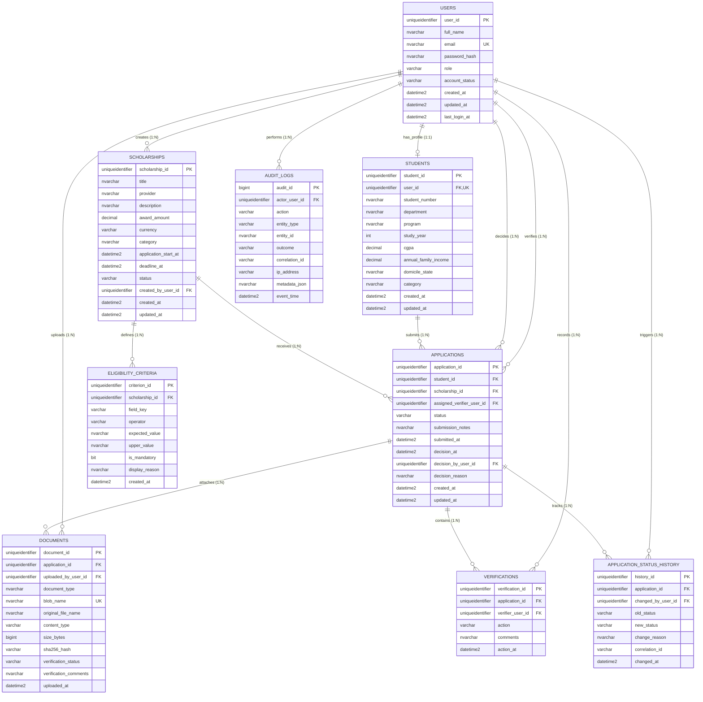

# ScholarSync — Entity Relationship Diagram & Data Dictionary

## 1. Mermaid Entity-Relationship Diagram

## 2. Normalization Verification (3NF)
- **1NF**: Every column contains atomic scalar values. No comma-separated criterion strings or document arrays.
- **2NF**: All non-key attributes are fully dependent on the primary key.
- **3NF**: No transitive dependencies. Student attributes reside solely in `Students`; scholarship details in `Scholarships`; applications link them using foreign keys.
