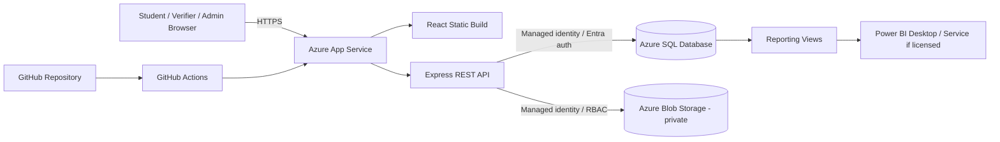
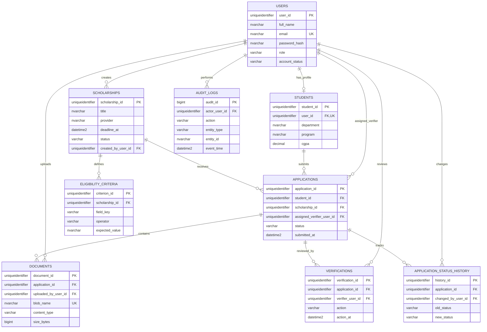

# ScholarSync — Complete Implementation Plan and Antigravity Build Specification

**Project:** ScholarSync — Smart Scholarship Application, Verification & Tracking Platform  
**Document:** `implementation plan.md`  
**Version:** 1.0  
**Status:** Master implementation handoff  
**Target agent:** Google Antigravity (or another coding agent with access to the project repository)  
**Execution mode:** Implement the complete codebase, tests, technical documentation, and Azure handoff materials. Do not stop after generating another plan.

---

# PART A — INSTRUCTIONS TO THE IMPLEMENTATION AGENT

## 1. Mission

You are the lead full-stack engineer for ScholarSync. Build a complete, working, secure, professional-quality web application from the project documents in this pack. The deliverable is a runnable codebase, database scripts, tests, documentation, and deployment assets—not a mockup, not a static UI, and not only a proposal.

Read these documents before editing code:

1. `user flow.md` — authoritative user journeys, role boundaries, workflow states, and acceptance criteria.
2. `USP.md` — product positioning and claims the final application must genuinely demonstrate.
3. `platforms.md` — selected services, exclusions, Azure architecture, Power BI licensing, and manual account-owner actions.
4. `implementation plan.md` — this master build specification.

Also inspect any existing repository files and any existing ScholarSync design document, ER diagram, or threat model. Preserve useful work. Do not overwrite or delete existing project content unless it is clearly obsolete and the reason is documented.

## 2. Non-Negotiable Rules

1. **Implement, do not merely describe.** Create source files, SQL scripts, tests, documentation, and deployment configuration.
2. **No fake production functionality.** Do not use hard-coded dashboard numbers, fake successful uploads, mock authentication, dummy API responses, or local-only data in the production path. Demo seed data is allowed only in a clearly labelled seed script/environment.
3. **No secrets in code.** Never commit database passwords, storage keys, JWT secrets, Power BI credentials, Azure publish profiles, or personal access tokens. Create `.env.example` with placeholders only.
4. **Do not access or modify the user's Azure subscription automatically.** Prepare Bicep/CLI assets and exact portal instructions. The user must manually review, approve, and deploy Azure resources.
5. **Do not assume Azure for Students includes Power BI Pro.** Implement Power BI as a separate reporting deliverable and explain licensing accurately in docs.
6. **Do not use public Power BI embedding for private student data.** Keep private website analytics inside the role-protected React application; Power BI sharing/embedding is optional and licence-dependent.
7. **Keep the baseline stack small.** No Supabase, Vercel, microservices, Python backend, or second database in the initial release.
8. **Respect role and object-level authorization on the server.** Frontend route guards are usability features, not security controls.
9. **Treat all browser data as untrusted.** Validate identifiers, roles, status values, files, dates, and text on the backend.
10. **Keep the project explainable for a two-member B.Tech team.** Use modular code, comments for important logic, clear naming, setup scripts, and documentation.
11. **Never claim a security control is complete without a test.** Mark it implemented only after the relevant test passes.
12. If an institutional decision is unresolved, implement the documented safe default below, make it configurable where sensible, and record it as a decision requiring faculty confirmation. Do not silently invent institution-specific rules.

## 3. Selected Technology Stack

### Frontend

- React.js with JavaScript.
- Vite build tooling.
- HTML5 and CSS3 (Tailwind CSS may be used for consistent styling, but do not sacrifice accessibility or maintainability).
- React Router for routes.
- A maintained chart library such as Recharts for the in-product analytics dashboard.
- Lucide icons or a similarly consistent icon set.
- Use a typed/validated API client layer; use Zod or equivalent for client-side form feedback where useful, while repeating all validation on the server.

### Backend

- Node.js LTS supported by the chosen Azure App Service runtime at implementation time.
- Express.js.
- JavaScript ES modules or a consistent CommonJS project; choose one and use it throughout.
- `mssql`/Tedious driver for Azure SQL, following Microsoft's current Node.js passwordless connection guidance.
- `@azure/identity` for managed identity / DefaultAzureCredential where supported.
- `@azure/storage-blob` for Blob Storage.
- `bcrypt` for password hashing as specified by the supplied project baseline; configure it safely and never store plaintext passwords. If you propose Argon2id instead, document the change and preserve the project security requirement.
- JWT/session library, secure HttpOnly cookies, CSRF protection for state-changing cookie-authenticated endpoints.
- Express security middleware (Helmet), request rate limiting, structured logging, centralized error handling, and schema validation.

### Data and cloud

- Azure SQL Database.
- Azure Blob Storage with a private container and anonymous access disabled.
- Azure App Service (Linux) hosting the Node.js/Express application and serving the built React assets.
- Git + GitHub.
- GitHub Actions CI/CD, preferably using federated OpenID Connect (OIDC) to Azure when the subscription/permissions support it.
- Power BI Desktop for the `.pbix` report; Power BI Service only if a separate suitable licence is confirmed.

## 4. High-Level Architecture



Use a modular monolith. React is built once and served by Express in production. API routes live under `/api`. Do not deploy the database or Blob Storage public credentials to the browser.

---

# PART B — REPOSITORY AND DELIVERABLE STRUCTURE

## 5. Required Repository Structure

Create or adapt this structure. Existing useful structure may be preserved if the same boundaries are clear.

```text
scholarsync/
├── client/
│   ├── index.html
│   ├── package.json
│   ├── vite.config.js
│   └── src/
│       ├── app/
│       ├── assets/
│       ├── components/
│       ├── features/
│       │   ├── auth/
│       │   ├── student/
│       │   ├── scholarships/
│       │   ├── applications/
│       │   ├── verifier/
│       │   ├── admin/
│       │   └── analytics/
│       ├── hooks/
│       ├── layouts/
│       ├── lib/
│       ├── pages/
│       ├── routes/
│       ├── styles/
│       └── main.jsx
├── server/
│   ├── package.json
│   └── src/
│       ├── app.js
│       ├── server.js
│       ├── config/
│       ├── database/
│       ├── middleware/
│       ├── modules/
│       │   ├── auth/
│       │   ├── users/
│       │   ├── students/
│       │   ├── scholarships/
│       │   ├── eligibility/
│       │   ├── applications/
│       │   ├── documents/
│       │   ├── verifications/
│       │   ├── analytics/
│       │   └── audit/
│       ├── services/
│       ├── utils/
│       └── validators/
├── database/
│   ├── migrations/
│   ├── schema.sql
│   ├── seed-demo.sql
│   ├── procedures.sql
│   ├── triggers.sql
│   ├── views.sql
│   └── README.md
├── docs/
│   ├── user flow.md
│   ├── USP.md
│   ├── platforms.md
│   ├── implementation plan.md
│   ├── ERD.md
│   ├── threat-model.md
│   ├── api-reference.md
│   ├── data-dictionary.md
│   ├── azure-manual-setup.md
│   ├── power-bi-setup.md
│   └── testing-evidence.md
├── infra/
│   ├── bicep/
│   │   ├── main.bicep
│   │   └── README.md
│   └── azure-setup-checklist.md
├── tests/
│   ├── api/
│   ├── integration/
│   └── e2e/
├── .github/workflows/
│   ├── ci.yml
│   └── deploy-azure.yml
├── .env.example
├── .gitignore
├── package.json
├── README.md
└── LICENSE (only if the team chooses one)
```

At minimum, the four supplied documents and the original ER/threat model should be copied into `docs/`. Update them only when implementation decisions change.

## 6. Root Scripts and Local Development

Provide simple, documented commands such as:

- `npm install` — install workspace dependencies.
- `npm run dev` — start frontend and backend for local development.
- `npm run build` — build frontend and prepare backend production output.
- `npm test` — run automated tests.
- `npm run lint` — lint supported code.
- `npm run db:check` or a documented SQL migration command — verify schema/migrations.

If npm workspaces are used, define them correctly at the root. Do not create scripts that refer to missing files. Verify every README command in a clean checkout.

---

# PART C — PRODUCT AND UI IMPLEMENTATION

## 7. Design Quality Requirements

Create a polished, modern, trustworthy scholarship portal suitable for an academic demonstration and a real usability test. The UI must look complete, not like a generic admin template with placeholder cards.

### Visual direction

- Clean institutional / education technology aesthetic.
- Strong typography hierarchy, restrained colour palette, consistent spacing, and clear content density.
- Consistent component system for buttons, inputs, cards, tables, dialogs, badges, alerts, breadcrumbs, side navigation, and pagination.
- Responsive layout from mobile to desktop.
- Clear visual separation between public pages, student workspace, verifier workspace, and admin workspace.
- Use real icons consistently; no emoji-based navigation.
- Use meaningful empty states and onboarding messages.
- Add realistic demo content from fictional sample data only.

### Required UI states

Every major screen must include loading, success, empty, validation-error, API-error, and permission-denied states where applicable. Do not leave blank panels or skeletons that never resolve.

### Accessibility

- Semantic HTML and proper labels.
- Keyboard-accessible menus, dialogs, tables, and forms.
- Visible focus indicator.
- Sufficient colour contrast.
- Status text/icon in addition to colour.
- Useful alt text for meaningful images.
- Do not use tiny text for legal/security notices.

## 8. Required Pages and Routes

### Public

- `/` — landing page, project purpose, calls to action.
- `/scholarships` — published scholarship search/filter/list.
- `/scholarships/:id` — public scholarship details and public eligibility summary.
- `/login`
- `/register`
- `/unauthorized` and `/not-found`

### Student

- `/student/dashboard` — profile completeness, eligible opportunities, application summary, recent activity.
- `/student/profile` — student profile fields required by eligibility rules.
- `/student/eligible-scholarships` — eligibility results and reasons.
- `/student/applications/new/:scholarshipId` — application form and document checklist.
- `/student/applications` — own application list.
- `/student/applications/:id` — own application detail, status history, clarification response.
- `/student/notifications` — only show real in-app events if implemented; never fake email/SMS delivery.

### Verifier

- `/verifier/dashboard`
- `/verifier/applications`
- `/verifier/applications/:id`
- Document review and clarification/recommendation action panels.

### Scholarship Admin

- `/admin/dashboard`
- `/admin/scholarships`
- `/admin/scholarships/new`
- `/admin/scholarships/:id/edit`
- `/admin/applications`
- `/admin/applications/:id`
- `/admin/assignments`
- `/admin/decisions`
- `/admin/analytics`
- `/admin/audit-logs` (restricted)

### System Admin

- `/system/users`
- `/system/users/:id`
- `/system/roles` (or a consolidated role-management screen)
- `/system/audit-logs`
- `/system/settings` only for implemented, safe settings

Frontend route guards improve the user experience but every route's API operations must independently enforce authorization.

## 9. Role-Specific UX Rules

- A student never sees another student's application in a list, detail page, search result, or document request.
- A verifier sees only assigned cases and the minimum necessary profile/document data.
- A Scholarship Admin sees operational scholarship/application information needed for administration and final decisions.
- A System Admin manages users and access but does not receive blanket file-content access by default.
- Public visitors see only published public scholarship data.

---

# PART D — DATABASE AND RDBMS IMPLEMENTATION

## 10. Database Model

Implement the nine core entities from the supplied project baseline. Use SQL Server/Azure SQL-compatible types and constraints. Use a surrogate key per table (uniqueidentifier or bigint identity) consistently; choose one strategy and document it. A UUID strategy is suitable for IDs exposed through APIs. Do not expose sequential internal identifiers unnecessarily.

### 10.1 `Users`

Purpose: application accounts and role identity.

Proposed fields:

- `user_id` — primary key.
- `full_name` — required.
- `email` — required, normalized, unique.
- `password_hash` — required for local-password accounts; never return from APIs.
- `role` — allowlisted value: `STUDENT`, `VERIFIER`, `SCHOLARSHIP_ADMIN`, `SYSTEM_ADMIN`.
- `account_status` — allowlisted value such as `ACTIVE`, `DISABLED`, `PENDING` if pending activation is implemented.
- `created_at`, `updated_at`, `last_login_at`.

### 10.2 `Students`

Purpose: student profile attributes needed by scholarship rules.

Proposed fields:

- `student_id` — primary key.
- `user_id` — unique foreign key to `Users` (one account to zero/one student profile).
- `student_number` — unique only if institutionally available and approved.
- `department`, `program`, `study_year`.
- `cgpa` — nullable decimal with a sensible check constraint.
- `annual_family_income` — nullable decimal only if required by supported criteria.
- `domicile_state`, `category` — only if required by scholarship rules.
- `created_at`, `updated_at`.

Do not add Aadhaar, bank account, or unnecessary sensitive attributes as default profile fields.

### 10.3 `Scholarships`

Purpose: scholarship metadata and publication lifecycle.

Proposed fields:

- `scholarship_id` — primary key.
- `title`, `provider`, `description`.
- `award_amount` and `currency` (nullable if not applicable).
- `application_start_at`, `deadline_at`.
- `status` — `DRAFT`, `PUBLISHED`, `CLOSED`, `ARCHIVED`.
- `created_by_user_id` — FK to `Users`.
- `created_at`, `updated_at`.

Enforce valid date ordering and allow only authorized Scholarship Admin users to publish/close records.

### 10.4 `EligibilityCriteria`

Purpose: normalized one-row-per-criterion rules linked to a scholarship.

Proposed fields:

- `criterion_id` — primary key.
- `scholarship_id` — FK to `Scholarships`.
- `field_key` — allowlisted profile field such as `cgpa`, `department`, `annual_family_income`, `domicile_state`, or `category`.
- `operator` — allowlisted operator such as `EQ`, `NE`, `GT`, `GTE`, `LT`, `LTE`, `IN`, `BETWEEN`.
- `expected_value` — validated scalar/string representation.
- `upper_value` — nullable for `BETWEEN`.
- `is_mandatory` — bit.
- `display_reason` — safe explanation shown to the student.
- `created_at`.

Never evaluate arbitrary SQL or JavaScript from these records. Implement a typed, allowlisted rule evaluator in the backend.

### 10.5 `Applications`

Purpose: student submission and current workflow state.

Proposed fields:

- `application_id` — primary key.
- `student_id` — FK to `Students`.
- `scholarship_id` — FK to `Scholarships`.
- `assigned_verifier_user_id` — nullable FK to `Users`.
- `status` — allowlisted workflow status from `user flow.md`.
- `submitted_at`, `decision_at`.
- `decision_by_user_id` — nullable FK to `Users`.
- `decision_reason` — nullable, mandatory for final decision.
- `created_at`, `updated_at`.

Default uniqueness: unique `(student_id, scholarship_id)` for one application per student per scholarship. If reapplication after rejection is approved, replace this with a documented policy rather than deleting historical applications.

### 10.6 `Documents`

Purpose: metadata for files stored in Blob Storage. The file bytes do not live in SQL.

Proposed fields:

- `document_id` — primary key.
- `application_id` — FK to `Applications`.
- `uploaded_by_user_id` — FK to `Users`.
- `document_type` — allowlisted document category.
- `blob_name` — opaque, unique storage object key; never a public URL.
- `original_file_name` — sanitized metadata.
- `content_type`, `size_bytes`, `sha256_hash` (optional integrity evidence).
- `verification_status` — `PENDING`, `ACCEPTED`, `REJECTED`, `REPLACED` as applicable.
- `uploaded_at`.

### 10.7 `Verifications`

Purpose: append-only review events.

Proposed fields:

- `verification_id` — primary key.
- `application_id` — FK to `Applications`.
- `verifier_user_id` — FK to `Users`.
- `action` — allowlisted review action.
- `comments` — bounded text; do not put secrets or unnecessary sensitive details here.
- `action_at`.

### 10.8 `ApplicationStatusHistory`

Purpose: complete status timeline.

Proposed fields:

- `history_id` — primary key.
- `application_id` — FK to `Applications`.
- `changed_by_user_id` — FK to `Users` or nullable for system event.
- `old_status`, `new_status`.
- `change_reason`.
- `changed_at`.

### 10.9 `AuditLogs`

Purpose: security/business audit trail.

Proposed fields:

- `audit_id` — primary key.
- `actor_user_id` — nullable FK to `Users` for system events.
- `action`, `entity_type`, `entity_id`, `outcome`.
- `event_time`.
- `correlation_id`.
- `metadata_json` — allowlisted, sanitized metadata only; no credentials, tokens, full documents, or unnecessary PII.

## 11. Relationships and ER Diagram

Create `docs/ERD.md` with a Mermaid ER diagram and export a readable PNG/SVG if the toolchain allows it. Preserve the nine core entities.



**Relationship notes:** `Users` has a one-to-zero-or-one relationship with `Students`. A Student can submit many Applications. A Scholarship can receive many Applications and define many EligibilityCriteria. An Application can have many Documents, Verifications, and status-history entries. User foreign keys also represent scholarship creators, assigned verifiers, uploaders, reviewers, status actors, and audit actors.

## 12. 3NF, Constraints, Indexes, and RDBMS Demonstration

Implement and document:

- 1NF: each field holds one atomic value; do not store repeating document lists or criteria lists in one delimited column.
- 2NF: non-key attributes depend on the whole key; use separate criterion, document, and verification rows rather than partial dependencies in repeating composite-key records.
- 3NF: non-key attributes depend on the key, the whole key, and nothing but the key; student details stay in `Students`, scholarship details stay in `Scholarships`, and applications reference them through FKs.
- Primary and foreign keys across the nine entities.
- `NOT NULL`, `UNIQUE`, `CHECK`, and foreign-key constraints.
- Indexes for actual query patterns such as `Applications(student_id)`, `Applications(scholarship_id, status)`, `Applications(assigned_verifier_user_id, status)`, `Scholarships(status, deadline_at)`, and `Documents(application_id)`.
- `ApplicationSummaryView` for approved reporting/administrative use.
- `vw_PowerBI_ApplicationMetrics` or equivalent aggregated/minimized reporting view.
- Stored procedure such as `usp_SubmitScholarshipApplication` or `usp_ChangeApplicationStatus`.
- A status-change trigger only if required by the RDBMS rubric and implemented as the single authoritative writer for status history/audit events.
- Transactions for application submission and controlled status updates.

### Avoid duplicate audit writes

Choose one authoritative mechanism for status-change history. Recommended implementation: all status updates pass through one backend service/stored procedure; a single SQL trigger or a single transaction service writes the status-history/audit record. Do not have both the trigger and the backend independently insert the same status-change history row. Document the chosen design and test exactly one history/audit event per transition.

## 13. Application Status Transition Enforcement

Implement a server-side transition map from `user flow.md`. The frontend may offer only valid actions, but the API and database must reject invalid transitions.

At minimum:

- Students can submit their own application and respond to a clarification request.
- Verifiers must be assigned to the case to review it.
- Verifiers can request clarification or record a recommendation; they cannot final-approve under the default policy.
- Scholarship Admin makes the final decision and must provide a reason.
- No role can edit status by sending an arbitrary string.
- Every valid transition writes old status, new status, actor, reason, timestamp, and correlation ID.

---

# PART E — BACKEND API IMPLEMENTATION

## 13A. First Administrative Account Provisioning

The public registration endpoint must always create a `STUDENT` role. It must never accept a role from the request body. Provide a safe first-administrator provisioning method for development/deployment (for example, a one-time CLI script that reads the initial administrator email and password from process environment, hashes the password, creates the account, and refuses to run if a privileged user already exists). Do not ship default admin credentials, seeded production passwords, or a public “make me admin” route. After bootstrap, role changes are restricted to an existing authorized System Admin and are audited.

## 14. API Conventions

- Base path: `/api`.
- JSON request/response for standard operations.
- HTTPS in deployed environments.
- Consistent response envelope, for example `{ "data": ..., "error": null, "meta": ... }` (choose one convention and use it everywhere).
- Predictable HTTP status codes.
- Server-side schema validation.
- Pagination and bounded filters for lists.
- Parameterized SQL only; no concatenation of user-controlled values into SQL.
- Correlation/request ID on responses and logs.
- Central error handler that hides stack traces and internals from the browser.
- Do not return password hashes, tokens, storage keys, SQL connection details, or internal stack traces.

## 15. Required Endpoint Inventory

### Authentication and account

| Method | Endpoint | Access | Purpose |
|---|---|---|---|
| POST | `/api/auth/register` | Public | Register a Student account |
| POST | `/api/auth/login` | Public, rate limited | Authenticate and issue secure session/token |
| POST | `/api/auth/logout` | Authenticated | Clear/invalidate session as implemented |
| GET | `/api/auth/me` | Authenticated | Return safe current-user profile and role |
| POST | `/api/auth/forgot-password` | Optional until email provider exists | Start safe recovery flow |
| POST | `/api/auth/reset-password` | Optional until email provider exists | Complete tokenized recovery |

### Student profile

| Method | Endpoint | Access | Purpose |
|---|---|---|---|
| GET | `/api/students/me` | Student | Get own profile |
| PUT | `/api/students/me` | Student | Update own profile |

### Scholarships and eligibility

| Method | Endpoint | Access | Purpose |
|---|---|---|---|
| GET | `/api/scholarships` | Public/authenticated | Paginated published scholarships |
| GET | `/api/scholarships/:id` | Public/authenticated | Scholarship detail and public criteria |
| POST | `/api/scholarships` | Scholarship Admin | Create scholarship draft |
| PUT | `/api/scholarships/:id` | Scholarship Admin | Update permitted scholarship fields |
| POST | `/api/scholarships/:id/publish` | Scholarship Admin | Validate and publish |
| POST | `/api/scholarships/:id/close` | Scholarship Admin | Close/stop applications |
| GET | `/api/scholarships/:id/eligibility` | Student | Evaluate current profile against criteria |

### Applications

| Method | Endpoint | Access | Purpose |
|---|---|---|---|
| POST | `/api/applications` | Student | Submit application after server checks |
| GET | `/api/applications` | Role-scoped | Student own; verifier assigned; admin authorized scope |
| GET | `/api/applications/:id` | Object-authorized | Get application detail |
| POST | `/api/applications/:id/clarification-response` | Owning Student | Respond to clarification |
| POST | `/api/applications/:id/withdraw` | Student if policy permits | Withdraw non-final application |
| POST | `/api/applications/:id/assign-verifier` | Scholarship Admin | Assign a verifier |
| POST | `/api/applications/:id/decision` | Scholarship Admin | Record final approval/rejection with reason |

### Documents

| Method | Endpoint | Access | Purpose |
|---|---|---|---|
| POST | `/api/applications/:id/documents` | Owning Student | Upload a permitted document |
| GET | `/api/applications/:id/documents` | Object-authorized | List safe metadata |
| GET | `/api/documents/:documentId/download` | Object-authorized | Download/stream through backend after access check |
| DELETE | `/api/documents/:documentId` | Student only when state/policy permits; otherwise admin policy | Soft-delete/mark replaced where allowed |

### Verification

| Method | Endpoint | Access | Purpose |
|---|---|---|---|
| GET | `/api/verifier/assignments` | Verifier | List assigned applications |
| POST | `/api/applications/:id/verifications` | Assigned Verifier | Record review action/comment |
| POST | `/api/applications/:id/clarification-requests` | Assigned Verifier or permitted Admin | Request clarification with reason |
| POST | `/api/applications/:id/recommendation` | Assigned Verifier | Recommend approval/rejection |

### Analytics and audit

| Method | Endpoint | Access | Purpose |
|---|---|---|---|
| GET | `/api/admin/analytics/overview` | Scholarship Admin/System Admin as permitted | Aggregate counts and trends |
| GET | `/api/admin/analytics/by-scholarship` | Scholarship Admin/System Admin | Scholarship aggregates |
| GET | `/api/admin/analytics/by-department` | Scholarship Admin/System Admin | Department aggregates |
| GET | `/api/admin/audit-logs` | Restricted Admin | Filtered audit records |

Antigravity may refine endpoint names but must preserve the functional inventory and access rules. Generate `docs/api-reference.md` from the final routes.

---

# PART F — SECURITY AND THREAT MODEL IMPLEMENTATION

## 16. Security Objectives

- **Confidentiality:** only authorized users access student records, applications, reports, and files.
- **Integrity:** eligibility rules, application statuses, document metadata, and decisions cannot be changed by unauthorized actors.
- **Availability:** the application handles expected failures gracefully and has a documented recovery approach.
- **Accountability:** important actions can be attributed to a user, time, target, and outcome.

## 17. Threat Register (STRIDE-Informed)

Risk ratings below are preliminary design ratings. Re-score after implementation and tests.

| ID | Threat / STRIDE category | Example attack | Impact | Required mitigation | Verification test |
|---|---|---|---|---|---|
| T01 | Spoofing | Credential stuffing or account takeover | Unauthorized access to personal records | Password hashing, login rate limiting, generic auth errors, secure cookies, expiry/revocation plan | Repeated-login throttling; invalid credentials never authenticate |
| T02 | Elevation of privilege | Student changes role in request body/JWT | Admin access | Role sourced from trusted server/database state; role mutation restricted; short-lived signed tokens/session refresh policy | Modify request role; API still treats user as Student |
| T03 | Broken object-level authorization | Student changes application/document ID | Disclosure/modification of another user's data | Ownership check on every application/document endpoint; verifier assignment check | Student A requests Student B's application/file and is denied |
| T04 | Tampering | Direct status update to `APPROVED` | Fraudulent scholarship decision | Server-side transition map; only admin final-decision permission; database procedure/constraint as appropriate | Student/verifier attempts direct final status; rejected and audited |
| T05 | Repudiation | Actor denies issuing a decision | Untraceable workflow | Append-only style audit/status records with actor, timestamp, reason, request ID | Decision and clarification events appear exactly once with correct actor |
| T06 | Information disclosure | SQL injection or overbroad API response | Student data leak | Parameterized SQL, minimal response DTOs, least privilege | Injection payload does not alter query; response excludes hashes/secrets |
| T07 | Information disclosure | Blob container made public or permanent URL shared | Sensitive document exposure | Private container; anonymous access disabled; backend authorization; short-lived narrow SAS only if needed | Anonymous request returns denied; unauthorized user cannot download |
| T08 | Tampering / DoS | Malicious or oversized uploaded file | Parser compromise, storage exhaustion | Allowlisted formats, MIME and signature checks, generated blob names, size limit, upload rate limit; scanning if available | Reject mismatched extension/signature and oversized files |
| T09 | Information disclosure | XSS in scholarship description/comment | Session/data compromise | Output encoding, safe rendering, input validation, restrictive CSP as appropriate | Store script payload; browser renders it inert |
| T10 | Cross-site request forgery | Browser automatically sends authenticated cookie | Unauthorized state-changing action | SameSite cookie plus CSRF token/origin checks for cookie-authenticated mutations | Cross-origin mutation without CSRF proof is rejected |
| T11 | Information disclosure | SQL/storage/JWT credentials committed to GitHub | Cloud resource compromise | Managed identity, secrets outside repo, `.gitignore`, secret scanning where available, rotation procedure | Repository scan and frontend bundle scan find no secret values |
| T12 | Denial of service | Flood login, search, or document upload | Service unavailable/cost spike | Rate limiting, pagination, input/file size limits, bounded queries, request timeout, basic monitoring | Load/abuse tests remain within configured limits |
| T13 | Information disclosure | Power BI Publish to web used for real student data | Public data leak | No confidential data in public reports; use React protected dashboard or licensed secure embedding | Review model fields and test access as anonymous user |
| T14 | Misconfiguration | Broad SQL firewall rule allows all Azure resources | Wider attack surface | Specific IP/VNet rules; avoid broad Azure-services rule; least privilege | Inspect SQL firewall rules before release |
| T15 | Repudiation / Log tampering | Audit log injection or sensitive data in logs | Misleading or exposed audit evidence | Structured logs; sanitize untrusted values; exclude credentials and file contents; restrict log access | CR/LF payload cannot forge entries; logs contain no secrets |

## 18. Required Security Controls

### Authentication

- Hash every password; never store plaintext.
- Use bcrypt as specified in the project stack with a reviewed work factor, or document an approved switch to a modern password-hashing algorithm.
- Use secure, HTTP-only, `Secure` cookies in production with appropriate `SameSite` settings.
- Use CSRF protection for state-changing cookie-authenticated requests.
- Apply rate limits to registration, login, and password reset.
- Use generic login errors to reduce account enumeration.
- Define session/token expiry and logout behaviour.

### Authorization

- Deny by default.
- Enforce role and object-level authorization on every API request.
- Student ownership: `application.student_id` must map to the authenticated user's student record.
- Verifier access: `assigned_verifier_user_id` must equal the authenticated verifier unless an approved override exists.
- Scholarship Admin: only defined scholarship/application administration capabilities.
- System Admin: user/role/security management; no blanket document access by default.
- Never trust role or owner IDs supplied by the browser.

### Database security

- Parameterized queries only.
- Dedicated application database principal with least required permissions.
- Prefer App Service managed identity and Microsoft Entra authentication over static production passwords.
- Do not connect as SQL server administrator from the application.
- Restrict network access; do not open SQL to all IPs.
- Use constraints and transactions as data-integrity controls.
- Do not expose raw SQL errors to clients.

### Blob/file security

- Private container and disabled anonymous access.
- Validate user permission before upload and download.
- Validate extension, MIME type, file signature, and size.
- Generate server-side opaque blob names.
- Keep Blob credentials out of the browser.
- Return files only through an authorized backend route or a narrowly scoped, short-lived user-delegation SAS created server-side where appropriate.
- Do not log file content or SAS tokens.

### Web security

- HTTPS only in deployment.
- Security headers through Helmet and a considered Content Security Policy.
- Safe output rendering; do not insert untrusted HTML.
- Restrictive CORS (same-origin in the baseline; explicit allowlist in split-host development).
- CSRF protection consistent with the selected cookie/token design.
- Dependency updates and vulnerability review.

### Secrets and deployment

- `.env.example` contains placeholders, not values.
- `.env`, local settings, certificates, generated deployment packages, and secrets are ignored by Git.
- Use managed identity for Azure SQL/Blob where supported.
- Use App Service configuration or Key Vault for the remaining server secrets.
- Use GitHub Actions OIDC/federated identity instead of a long-lived Azure publish profile when supported.
- Never expose secret values in logs, screenshots, README, or client bundles.

### Logging and audit

- Structured application logs.
- Correlation/request ID on requests and audit records.
- Log authentication failures, authorization denials, status changes, role changes, file events, and administrative actions.
- Restrict audit access.
- Do not log passwords, session tokens, JWTs, connection strings, SAS URLs, full file contents, or unnecessary personal data.
- Avoid duplicate records from both application service and database trigger.

## 19. Security Test Set

Create automated API/integration tests for:

1. Student A cannot read Student B's application.
2. Student A cannot upload/download files against Student B's application.
3. An unassigned verifier cannot access an application.
4. A verifier cannot final-approve or final-reject under the default policy.
5. A student cannot assign themselves a privileged role.
6. A student cannot manipulate eligibility result/status fields in the request.
7. SQL injection strings are treated as data.
8. Script payloads are not executed in scholarship descriptions/comments.
9. Unsupported/mismatched/oversized file types are rejected.
10. Anonymous access to the Blob container is denied.
11. Cookies have secure production attributes; CSRF mutation checks work.
12. Secrets are not returned in API responses or client build artifacts.
13. Invalid status transitions are rejected and audited.
14. Power BI reporting view excludes direct student identifiers and document references.

---

# PART G — POWER BI IMPLEMENTATION

## 20. Power BI Deliverable

Power BI must be implemented as a real analytics artefact, not a screenshot-only placeholder. Power BI Desktop is a free Windows report-authoring application; the Power BI Service sharing/embedding licence is separate from Azure for Students credits.

### Required work

1. Create a minimized/aggregate SQL reporting view such as `vw_PowerBI_ApplicationMetrics`.
2. Create a dedicated read-only reporting principal or use a suitable read-only identity.
3. Connect Power BI Desktop to Azure SQL Database.
4. Import only approved reporting columns.
5. Build report pages:
   - Overview: total applications and outcome counts.
   - Scholarship analysis: application volume by scholarship.
   - Department analysis: application volume by department.
   - Time trends: monthly submission counts and outcomes.
6. Reconcile every displayed KPI with a SQL query and record the test result.
7. Save the `.pbix` in the project deliverable location if it does not contain sensitive production data or credentials. Otherwise keep the file outside the repository and document where the team stores it.
8. Document refresh and licence requirements in `docs/power-bi-setup.md`.

### Website dashboard

The React administrator dashboard must use secured `/api/admin/analytics/*` endpoints and render aggregate data in React charts/cards. Do not embed the Power BI report publicly into the private admin site. Secure Power BI embedding may be added only if an appropriate Pro/PPU or capacity model is confirmed and the user chooses to pay/obtain it.

### Licensing fact to preserve in documentation

Azure for Students credits are for eligible Azure resource consumption and do not automatically include Power BI Pro or paid Power BI Embedded/Fabric capacity. The student offer is intended for education, non-commercial research, and designing/developing/testing/demonstrating applications; check its current terms before treating it as a public commercial production host. Power BI free licence can support personal use, but sharing and secure embedding have separate licence/capacity rules. Publish to web is public and is prohibited for confidential student data.

---

# PART H — AZURE PROVISIONING AND MANUAL USER ACTIONS

## 21. What Antigravity Must Prepare Automatically

Create the following files and instructions without accessing the user's subscription:

- `infra/bicep/main.bicep` with parameterized resource definitions where feasible.
- `infra/bicep/README.md` with prerequisites, deployment command, parameter meanings, and safe teardown warnings.
- `docs/azure-manual-setup.md` with exact Azure Portal navigation steps and expected values.
- `docs/azure-cost-checklist.md` or a cost section in the setup guide.
- `.env.example` with all required variable names and placeholder values.
- A GitHub Actions CI workflow for build/test.
- A GitHub Actions Azure deployment workflow template using OIDC where supported.
- A post-deployment smoke-test script/checklist.

Do not include actual tenant IDs, subscription IDs, passwords, keys, or tokens in generated documentation.

## 22. What the Student Must Do Manually in Azure

The final Azure menu labels can change, so the guide must be verified against the current portal before the student follows it. At minimum, document these actions:

### A. Subscription and cost

1. Sign in to the Azure portal with the account that owns the Azure for Students subscription.
2. Confirm the correct subscription is active.
3. Check the remaining student credit and expiry date.
4. Select a region and create a resource group.
5. Review current pricing/SKU limits for SQL, App Service, storage, logging, and bandwidth.
6. Set budget alerts. Explain that alerts do not guarantee an automatic shutdown.

### B. Azure SQL Database

1. Create the Azure SQL logical server and database.
2. Configure a Microsoft Entra administrator.
3. Apply the schema/migrations generated in `database/`.
4. Create/enable the App Service managed identity.
5. Create a database user for that managed identity and grant only required permissions.
6. Configure firewall/network access narrowly. Do not enable broad Azure-services access without a documented temporary exception and security review.
7. Configure a separate least-privilege read-only principal or view access for Power BI.

### C. Azure Blob Storage

1. Create the storage account.
2. Turn off anonymous Blob access at the account level.
3. Create a private `application-documents` container.
4. Assign the App Service identity the required Blob data role at the narrowest practical scope.
5. Verify a private blob cannot be fetched anonymously.
6. Confirm no storage account key is placed in the frontend or GitHub.

### D. Azure App Service

1. Create a Linux App Service with a Node runtime supported by the current service.
2. Enable system-assigned managed identity.
3. Enable HTTPS-only.
4. Configure app settings from `.env.example` after replacing placeholders in the portal. Do not place secrets into a committed file.
5. Configure health check/logging options appropriate to the chosen tier.
6. Verify the app can access Azure SQL and Blob Storage through its assigned identity.

### E. GitHub deployment

1. Push the code to the selected GitHub repository.
2. Configure the Azure federated identity / OIDC trust for the repository and branch/environment.
3. Assign only the minimum deployment role.
4. Add non-secret repository variables required by the workflow.
5. Run CI and deploy workflow.
6. Verify deployment logs and live URL.

### F. Power BI

1. Install Power BI Desktop.
2. Sign in using the university/student Microsoft account if supported.
3. Check the account's actual Power BI licence separately from the Azure subscription.
4. Connect to the approved Azure SQL reporting view.
5. Create and save the `.pbix` report.
6. Publish/share online only if the user's licence, tenant settings, and data classification permit it.

## 23. Environment Variable Contract

Create `.env.example` with placeholders and validate required variables at application startup. Likely variables include:

```dotenv
NODE_ENV=development
PORT=4000
APP_BASE_URL=http://localhost:5173
API_BASE_PATH=/api

# Authentication: use a strong locally generated secret only for local development.
JWT_SECRET=REPLACE_WITH_LOCAL_DEV_SECRET
JWT_ACCESS_TTL=15m
COOKIE_NAME=scholarsync_session
COOKIE_SECURE=false
COOKIE_SAME_SITE=lax

# Azure SQL - local development may use an approved local Entra/SQL dev method.
AZURE_SQL_SERVER=your-server.database.windows.net
AZURE_SQL_DATABASE=ScholarSync
AZURE_SQL_AUTH_MODE=default-azure-credential

# Azure Blob - use managed identity in Azure; do not place account keys in frontend.
AZURE_STORAGE_ACCOUNT=yourstorageaccount
AZURE_STORAGE_CONTAINER=application-documents

# File controls
MAX_UPLOAD_BYTES=5242880
ALLOWED_UPLOAD_MIME_TYPES=application/pdf,image/jpeg,image/png

# Optional monitoring
APPLICATIONINSIGHTS_CONNECTION_STRING=
```

Do not make production startup silently fall back to insecure defaults. Validate environment settings and fail clearly if a required production secret or resource configuration is missing. If `APP_BASE_URL` is used for CORS/CSRF checks, restrict it to the known production origin.

---

# PART I — TESTING, QUALITY, AND DEFINITION OF DONE

## 24. Test Strategy

### Unit tests

- Eligibility operator evaluation and boundary conditions.
- Application status transition map.
- Request validators.
- Role/permission helpers.
- Safe filename/blob-name generation.
- Analytics aggregation transformations.

### API tests

- Authentication and role middleware.
- Student profile and ownership.
- Scholarship CRUD and publication permissions.
- Eligibility route.
- Application submission/duplicate prevention.
- Upload/download access control.
- Verification, clarification, recommendation, and final decision.
- Analytics role restrictions.

### Database integration tests

- Schema creates successfully on Azure SQL-compatible SQL Server.
- PK/FK/unique/check constraints work.
- Submission and status transactions commit/rollback correctly.
- View, stored procedure, and trigger work as documented.
- Exactly one history/audit event is written per status transition.

### End-to-end tests

- Student journey from registration to tracking.
- Verifier journey from assigned queue to recommendation.
- Scholarship Admin journey from scholarship setup to final decision.
- System Admin role-management journey.
- Negative test: one user cannot access another user's application/file.

### Security and deployment tests

- SQL injection, XSS payload, CSRF, IDOR/object access, role escalation, upload restrictions, public Blob access, secret scanning, and API rate limiting.
- Live smoke test: landing page loads, login works, APIs respond, Azure SQL connection works, document upload/download is authorized, and admin analytics render.

## 25. Code Quality and Engineering Requirements

- Use a consistent formatter and linter.
- Keep business logic out of React presentation components and Express route handlers.
- Use controller/service/repository boundaries where useful without overengineering.
- Centralize constants for roles, statuses, allowed file types, and eligibility operators.
- Use a single database connection pool with safe lifecycle handling.
- Use parameterized queries and bounded pagination.
- Use database migrations or versioned SQL scripts; do not rely on manual one-off schema edits.
- Provide structured logs with correlation IDs and safe redaction.
- Add meaningful comments for non-obvious security and transaction logic.
- Keep API and database errors generic for the client and detailed only in protected server logs.
- Do not create dead routes, broken links, unused buttons, or forms that appear to submit but do not persist data.

## 26. Definition of Done

The implementation is complete only when:

- The project installs and runs from a clean checkout using README instructions.
- Every role can sign in and sees the correct navigation and pages.
- The complete student/verifier/administrator workflow operates using backend APIs and Azure SQL.
- Documents are stored in private Blob Storage and object-level access controls pass tests.
- All nine core entities and their constraints/relationships are present.
- The required RDBMS elements (3NF rationale, PK/FK, constraints, indexes, view, stored procedure, trigger, transaction) are implemented and documented.
- The React in-product dashboard uses real authorized aggregate API data.
- The Power BI report connects to the approved SQL reporting view and reconciles to SQL totals.
- Threat mitigations are implemented and tested; unresolved risks are explicitly documented.
- CI tests pass; deployment workflow is documented and works when the student supplies Azure resource identifiers/permissions.
- Azure manual steps are complete or clearly marked pending; no false claim of live deployment is made.
- README, API reference, ERD, threat model, database dictionary, setup guide, and test evidence are current.

---

# PART J — PHASED EXECUTION ORDER

## 27. Phase Plan and Deliverables

| Phase | Work | Required output / acceptance gate |
|---|---|---|
| 0. Repository inspection | Inspect existing code, docs, ERD, diagrams, and repository; report gaps | Preserve useful work; final repo plan recorded |
| 1. Project scaffold | Create React/Vite client, Express server, scripts, lint/test setup, env validation | Clean local startup and health route |
| 2. Database design | Create schema/migrations for nine entities, constraints, indexes, ERD, data dictionary | SQL scripts run successfully; ERD matches schema |
| 3. Auth and RBAC | Registration, login, cookie/session/CSRF, password hashing, role middleware | Auth tests and negative role tests pass |
| 4. Scholarship module | Listing, filtering, scholarship admin CRUD, criteria management, publication | Public pages show only published scholarships |
| 5. Eligibility engine | Typed allowlisted criteria evaluator and explanation output | Eligible/ineligible/incomplete cases pass tests |
| 6. Student module | Profile, application form, submission, application list/detail/tracking | Student can submit and view own application only |
| 7. Blob documents | Private container integration, upload/download, metadata, cleanup strategy | File restrictions and cross-user access tests pass |
| 8. Verification workflow | Assigned queues, review, clarification loop, recommendation, final decision | Full workflow and transition history pass |
| 9. Audit and security | Audit events, security headers, rate limits, validation, threat tests | Threat register controls have evidence |
| 10. Analytics | Admin React dashboard, SQL aggregate views, Power BI `.pbix` | Dashboard and report totals reconcile to SQL |
| 11. Cloud infrastructure | Bicep template, manual Azure setup docs, identity/network guide | User can provision resources by following steps |
| 12. CI/CD and deployment | GitHub Actions test/build/deploy with OIDC template | CI passes; deployment works after manual Azure setup |
| 13. Final QA and docs | E2E tests, accessibility check, README, screenshots, test evidence, viva notes | All definition-of-done items checked or openly marked pending |

## 28. Two-Member Work Division (Suggested)

| Member | Primary ownership | Shared responsibilities |
|---|---|---|
| Member 1 | React UI, public pages, student module, verifier/admin screens, frontend tests | Architecture walkthrough, API contract review, end-to-end demo |
| Member 2 | Express APIs, Azure SQL schema, Azure Blob, auth/RBAC, Azure deployment, reporting integration | Security tests, data model review, documentation, demo |

Both members must understand the complete flow, data model, Azure resource boundaries, and threat model. Git commit history must represent actual work; do not fabricate contributions.

---

# PART K — OPEN DECISIONS AND SAFE DEFAULTS

## 29. Decisions Requiring Faculty / Owner Confirmation

| Decision | Safe implementation default | Confirmation needed |
|---|---|---|
| Final approval authority | Scholarship Admin makes final decision; verifier recommends | Yes, faculty/institution |
| Reapplication policy | One application per student per scholarship | Yes |
| Eligibility fields/operators | Allowlisted profile fields and operators defined in this plan | Yes, confirm actual scholarship rules |
| Draft applications | Optional; if included, drafts are not submitted or visible to verifiers | Yes |
| File formats/size | Configurable PDF/JPEG/PNG allowlist and conservative size limit | Yes |
| Malware scanning | Do not claim scanning unless a configured scanner is present | Yes, based on Azure budget/service availability |
| Notifications | In-app activity/status history only until a real email/SMS provider is configured | Yes |
| Power BI sharing | Local `.pbix` report; private website charts in React | Yes, if online Power BI embedding is required |
| Data retention | Document a proposed retention policy; do not delete automatically without approval | Yes |
| Private networking | Use the most restrictive network design supported by the chosen student plan/SKU; document any demo exception | Yes, owner chooses SKU/cost |

## 30. Final Agent Response Required

After implementation, provide a concise but complete handover containing:

1. What code and features were actually implemented.
2. Repository/folder structure created or changed.
3. Commands to install, run, test, and build locally.
4. SQL schema/migration deployment instructions.
5. Azure resources that must be created manually.
6. Exact portal settings/roles/values the student must configure, with no secret values.
7. GitHub Actions/OIDC setup steps and required non-secret identifiers.
8. Power BI Desktop connection and report setup steps, plus the user's separate licence limitation.
9. Test results, including failed or skipped tests.
10. Known gaps and unresolved faculty decisions.
11. Do not claim “deployed” or “production-ready” unless a live deployment and relevant tests have actually succeeded.

---

## Official Technical References

Use current Microsoft and OWASP guidance during implementation. If a Microsoft portal label or SDK API has changed, follow the current official documentation and update the generated setup guide.

### Azure and Power BI

- [Azure for Students](https://learn.microsoft.com/en-us/azure/education-hub/about-azure-for-students)
- [Azure for Students FAQ](https://learn.microsoft.com/en-us/azure/education-hub/faq)
- [Node.js passwordless connection to Azure SQL Database](https://learn.microsoft.com/en-us/azure/azure-sql/database/azure-sql-javascript-mssql-quickstart)
- [Azure App Service managed identity](https://learn.microsoft.com/en-us/azure/app-service/overview-managed-identity)
- [Azure Blob Storage security guide](https://learn.microsoft.com/en-us/azure/storage/common/storage-security-guide)
- [Secure Azure Blob Storage](https://learn.microsoft.com/en-us/azure/storage/blobs/secure-blobs)
- [Azure SQL network access controls](https://learn.microsoft.com/en-us/azure/azure-sql/database/network-access-controls-overview)
- [Deploy to App Service using GitHub Actions](https://learn.microsoft.com/en-us/azure/app-service/deploy-github-actions)
- [Power BI Desktop is a free Windows application](https://learn.microsoft.com/en-us/power-bi/fundamentals/desktop-getting-started)
- [Power BI licence types](https://learn.microsoft.com/en-us/power-bi/fundamentals/service-features-license-type)
- [Securely embed Power BI](https://learn.microsoft.com/en-us/power-bi/service-embed-secure)
- [Power BI Publish to web](https://learn.microsoft.com/en-in/power-bi/collaborate-share/service-publish-to-web)

### OWASP security guidance

- [Authorization Cheat Sheet](https://cheatsheetseries.owasp.org/cheatsheets/Authorization_Cheat_Sheet.html)
- [File Upload Cheat Sheet](https://cheatsheetseries.owasp.org/cheatsheets/File_Upload_Cheat_Sheet.html)
- [SQL Injection Prevention Cheat Sheet](https://cheatsheetseries.owasp.org/cheatsheets/SQL_Injection_Prevention_Cheat_Sheet)
- [Authentication Cheat Sheet](https://cheatsheetseries.owasp.org/cheatsheets/Authentication_Cheat_Sheet.html)
- [Password Storage Cheat Sheet](https://cheatsheetseries.owasp.org/cheatsheets/Password_Storage_Cheat_Sheet.html)
- [CSRF Prevention Cheat Sheet](https://cheatsheetseries.owasp.org/cheatsheets/Cross-Site_Request_Forgery_Prevention_Cheat_Sheet.html)
- [Logging Cheat Sheet](https://cheatsheetseries.owasp.org/cheatsheets/Logging_Cheat_Sheet.html)
