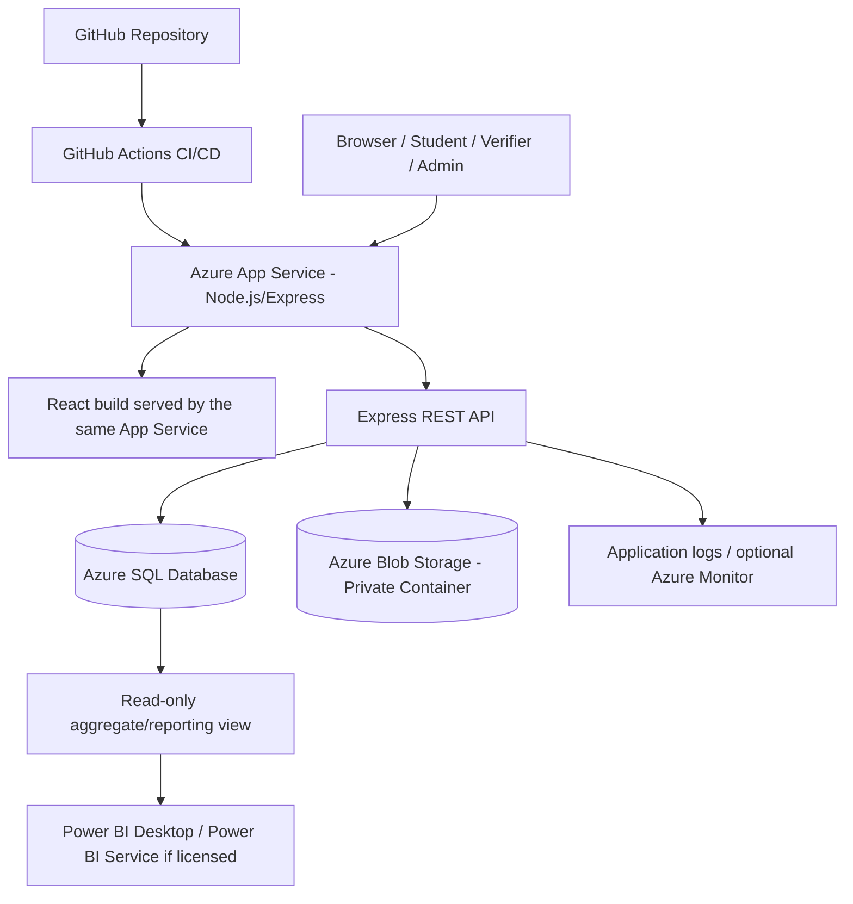

# ScholarSync — Platforms, Services, and Technology Stack

**Project:** ScholarSync — Smart Scholarship Application, Verification & Tracking Platform  
**Document:** `platforms.md`  
**Version:** 1.0  
**Status:** Approved proposed stack for implementation; Azure resource provisioning remains a manual owner action

---

## 1. Executive Decision

ScholarSync will use **GitHub + Microsoft Azure + Microsoft Power BI** as its primary platform ecosystem.

- **GitHub** stores the source code, issue history, team contributions, and CI/CD workflow.
- **Microsoft Azure** hosts the application, relational database, and uploaded documents.
- **Microsoft Power BI** provides the formal analytics/reporting deliverable connected to approved Azure SQL reporting data.
- **Vercel** is not part of the initial deployment path. It is a possible alternate frontend host, but it would create a second hosting platform without a requirement in the current architecture.
- **Supabase** is not used in the baseline. Its database, authentication, and storage capabilities overlap with Azure SQL, the application's own Node/Express authentication, and Azure Blob Storage.

### Final platform decision

| Platform | Decision | Why |
|---|---|---|
| GitHub | **Use** | Source control, team collaboration, commit evidence, automated deployment |
| Microsoft Azure | **Use as primary cloud** | Azure SQL, Blob Storage, App Service, managed identity, cloud hosting |
| Microsoft Power BI | **Use for analytics** | Connect to Azure SQL reporting views and create a `.pbix` analytics report |
| Vercel | **Do not use initially** | Azure App Service already fulfils the planned hosting design; avoid unnecessary multi-host complexity |
| Supabase | **Do not use** | Duplicates the selected database, storage, and authentication responsibilities |

## 2. Target Architecture



### Hosting decision

For the first release, build the React frontend and Express backend as one deployable web application:

- React is built to static assets.
- Express exposes `/api/*` routes.
- In production, Express serves the React build for non-API routes.
- Azure App Service hosts the Node.js process.

This same-origin design simplifies cookies, CORS, and deployment. If the team later chooses separate hosting, update CORS, cookie, CSRF, and deployment configuration deliberately.

## 3. GitHub — What Will Be Used

| GitHub capability | ScholarSync use | Required setup |
|---|---|---|
| Repository | Store `client`, `server`, SQL, docs, tests, and infrastructure templates | Create a private repository initially; change visibility only after reviewing contents |
| Git | Track meaningful work by both team members | Use topic branches and readable commits |
| Pull requests | Review changes before merging | Require review for important security/database changes where practical |
| Issues / Projects (optional) | Track implementation tasks and bugs | Use labels such as frontend, backend, database, Azure, security, and documentation |
| GitHub Actions | Run tests/build and deploy to Azure App Service | Prefer federated OpenID Connect (OIDC) where supported; avoid long-lived deployment secrets |
| GitHub Secrets / Variables | Store only values needed by the workflow | Never place application secrets in committed files or logs |

### Suggested repository layout

```text
scholarsync/
├── client/
├── server/
├── database/
│   ├── migrations/
│   ├── schema.sql
│   ├── seed-demo.sql
│   └── reporting-views.sql
├── docs/
│   ├── user-flow.md
│   ├── USP.md
│   ├── platforms.md
│   ├── implementation-plan.md
│   ├── ERD.md
│   ├── threat-model.md
│   └── azure-manual-setup.md
├── infra/
│   └── bicep/
├── tests/
├── .github/workflows/
├── .env.example
├── .gitignore
└── README.md
```

The four top-level handoff documents supplied with this pack should be copied into `docs/` with the exact names shown above.

## 4. Microsoft Azure — Services and Responsibility

### 4.1 Azure for Students subscription and credits

The Microsoft Azure for Students offer currently describes **USD $100 in Azure credit for 12 months**, with renewal available to eligible active students, plus access to select free Azure services. Charges for eligible billable Azure resources consume the credit. Microsoft states that if the credit is exhausted or the offer expires and the subscription is not upgraded/renewed as permitted, deployed services can be disabled/decommissioned. The offer is intended for education/teaching, non-commercial research, and designing, developing, testing, and demonstrating applications; do not assume it is suitable for operating a commercial production service. Check the current terms and the balance in the Azure Sponsorships portal before provisioning.

**Important licensing correction:** Azure for Students credit is an Azure consumption benefit. It does **not automatically grant Power BI Pro, Premium Per User, or paid Power BI Embedded/Fabric capacity** merely because the student signs in with the same Microsoft identity. Power BI has its own per-user licences and capacity rules. The student's university Microsoft 365 account may separately have a Power BI entitlement, but that must be checked in the account/licence page or with the university IT administrator.

Official source: [What is Azure for Students?](https://learn.microsoft.com/en-us/azure/education-hub/about-azure-for-students)

### 4.2 Azure App Service — Application hosting

**Purpose:** Host the Node.js/Express application and the built React frontend at the public ScholarSync URL.

**What the team will use:**

- Linux App Service with a Node.js runtime supported by the current App Service stack.
- A single application process for the modular monolith.
- App Service application settings for non-secret configuration and references to secret stores as configured.
- System-assigned managed identity for Azure resource access where supported.
- Deployment through GitHub Actions.
- HTTPS-only configuration and health endpoint.

**What Antigravity should create:**

- A production-ready Node start command and health route.
- A deployable build that serves React static assets and `/api/*` endpoints.
- GitHub Actions workflow template.
- `infra/azure-manual-setup.md` with the portal steps, resource names, runtime setting, environment variables, identity, and troubleshooting notes.

**What the student must do manually:**

- Select the Azure subscription, region, resource group, and App Service plan/SKU.
- Create the App Service or deploy the supplied infrastructure template after reviewing cost and permissions.
- Enable HTTPS-only and configure the managed identity.
- Configure the production environment settings.
- Configure the GitHub-to-Azure federated identity/deployment permissions.
- Verify the live URL and logs.

**Cost warning:** an Azure credit is not a guarantee that every App Service plan/SKU is free. Choose the lowest tier that supports the needed runtime and project demonstration, verify its current regional price/limits, and monitor credit usage.

### 4.3 Azure SQL Database — Relational data

**Purpose:** Store structured, relational application data.

Core entities:

1. `Users`
2. `Students`
3. `Scholarships`
4. `EligibilityCriteria`
5. `Applications`
6. `Documents` (metadata only)
7. `Verifications`
8. `ApplicationStatusHistory`
9. `AuditLogs`

**What is stored in Azure SQL:** identities/account metadata, student profile fields needed for eligibility, scholarship records, rule definitions, application records, document metadata, verifier actions, status history, and audit events.

**What is not stored in Azure SQL:** the PDF/image bytes of marksheets, income certificates, or other supporting files. Those bytes belong in Blob Storage.

**RDBMS requirements:**

- Normalize the core schema to 3NF where appropriate.
- Define primary keys and foreign keys.
- Define `NOT NULL`, `UNIQUE`, `CHECK`, and referential constraints.
- Add indexes based on actual filter/join columns.
- Create `ApplicationSummaryView` for approved application reporting.
- Create a read-only aggregate view for Power BI that excludes direct identifiers and document metadata.
- Implement a stored procedure for a key workflow operation, such as controlled status changes or application submission.
- Implement a trigger for automatic audit/status-history capture if required by the course rubric; choose one authoritative writer to prevent duplicate records.
- Use SQL transactions for application submission and status changes.

**Identity and connection:** use Microsoft Entra authentication and App Service managed identity for the deployed app where supported. Prefer passwordless, short-lived identity-based access over storing a SQL administrator password in App Service settings. Create a database principal for the App Service identity and grant only the required database roles/permissions. For local development, use a developer-specific Entra login or a separately documented local credential that is never committed.

Official source: [Connect to Azure SQL from Node.js using a passwordless approach](https://learn.microsoft.com/en-us/azure/azure-sql/database/azure-sql-javascript-mssql-quickstart)

### 4.4 Azure Blob Storage — Document files

**Purpose:** Store the actual uploaded supporting documents.

**Configuration requirements:**

- Create a storage account in the same suitable region as the application/database where practical.
- Create a private container, for example `application-documents`.
- Disable anonymous/public blob access at the storage-account level.
- Do not enable the static website endpoint for the private documents account.
- Give the App Service managed identity only the storage data permissions required to upload/read/delete application documents.
- Use generated opaque blob names; retain safe original filename metadata in SQL.
- Do not expose account keys in React, source code, query strings, client logs, or GitHub.
- Download only through an authenticated, authorized backend route. If a short-lived SAS is ever used, create it server-side with narrow permissions and expiry; never issue a permanent/public URL.

Official sources: [Secure your Azure Blob Storage](https://learn.microsoft.com/en-us/azure/storage/blobs/secure-blobs) and [Azure Storage security recommendations](https://learn.microsoft.com/en-us/azure/storage/common/storage-security-guide).

### 4.5 Azure SQL network configuration

Azure SQL denies network access by default and offers IP firewall rules and private networking options. Do not blindly enable **Allow Azure services and resources to access this server**: Microsoft documents that it adds a broad `0.0.0.0` rule allowing connections from resources within the Azure boundary, including resources outside the team's subscription.

For a student demonstration:

- Keep the SQL public endpoint closed to general internet access.
- Add only the development IP required for local development, then remove it when no longer required.
- For App Service connectivity, evaluate the current App Service outbound IP allowlist and/or an appropriate private networking design supported by the selected SKU/region.
- If the team temporarily uses the broad Azure-services switch to unblock a non-production demo, document it as a temporary exception, use least-privilege SQL identity, restrict database permissions, and remove it before treating the deployment as production-like.
- Do not use `0.0.0.0–255.255.255.255` or other all-internet rules.

Official source: [Azure SQL Database network access controls](https://learn.microsoft.com/en-us/azure/azure-sql/database/network-access-controls-overview).

### 4.6 Azure Key Vault — Optional hardening

Key Vault is not required to prove the initial coursework workflow. First use managed identities for SQL and Blob access so that no storage key or SQL password is needed by the running application. If a third-party email provider or another integration introduces secrets, evaluate Key Vault and its cost/permissions before adding it. Do not add a service simply to increase the technology count.

### 4.7 Azure Monitor / Application Insights — Optional observability

Useful for collecting operational telemetry, request failures, and performance data. It may create ingestion/storage charges. Start with structured application logging and App Service logs. Add Application Insights only after checking student credit and configuring redaction so that tokens, documents, and sensitive student data are not captured.

## 5. Microsoft Power BI — Required Analytics Platform

### 5.1 What will be used

- **Power BI Desktop:** create and save the formal `.pbix` report on a Windows development machine. Power BI Desktop is a free Windows application for connecting to data and authoring reports.
- **Azure SQL connector:** connect Power BI Desktop to approved, read-only Azure SQL data.
- **Reporting views:** use a dedicated reporting view (preferably aggregate or minimized data) rather than granting Power BI broad operational table access.
- **Power BI Service:** use only if the user's account has the necessary licence and the project requires online publishing/sharing.

### 5.2 Reports to create

- Total application count.
- Approved / rejected / pending / under-review counts.
- Applications by scholarship.
- Applications by department.
- Monthly submission trend.
- Approval/rejection trend, where sufficient sample data exists.

All displayed numbers must be reconciled against SQL queries. Use demo/anonymized data in screenshots and presentations.

### 5.3 What Power BI is not doing

Power BI is not the application's authentication system, not its transactional database, not document storage, and not the mechanism that enforces student/verifier/admin permissions inside ScholarSync.

The in-product administrator dashboard should use the secured React + Express analytics API. Power BI is the separate analytics/reporting deliverable. This approach keeps the website functional without relying on paid report embedding.

### 5.4 Licensing — critical distinction

| Power BI capability | Free per-user licence | Pro / qualifying capacity |
|---|---|---|
| Create reports for personal use in own workspace | Yes, subject to service capability | Yes |
| Share/collaborate in ordinary shared workspaces | No | Pro/PPU or qualifying capacity rules apply |
| Securely embed report in a private portal | Not sufficient by itself | Viewer licences or qualifying capacity required |
| Publish to web | May be available for eligible reports/accounts and tenant configuration | Also subject to report and tenant eligibility |

**Publish to web is public.** Anyone who obtains the link/embed can view the report, and the underlying semantic model may expose detail-level data beyond what is visually displayed. Do not use it for private student records, names, IDs, income data, documents, or any confidential information. It does not apply row-level security as a protection mechanism.

**Azure for Students does not automatically include Power BI Pro or Embedded/Fabric capacity.** Check the Microsoft 365/Power BI licence attached to the university account separately. A student may have access to Power BI Desktop and a free Power BI Service licence without having the rights to share reports with all visitors.

**Baseline delivery:** build the `.pbix` report with Power BI Desktop and keep the ScholarSync website analytics dashboard in React. Add secure Power BI embedding only after confirming a suitable licence/capacity and data permissions.

Official sources:

- [Power BI Desktop is free — Microsoft Learn](https://learn.microsoft.com/en-us/power-bi/fundamentals/desktop-getting-started)
- [Power BI service features by licence type](https://learn.microsoft.com/en-us/power-bi/fundamentals/service-features-license-type)
- [Embed a report securely in a portal or website](https://learn.microsoft.com/en-us/power-bi/service-embed-secure)
- [Publish to web from Power BI — security and public-access warning](https://learn.microsoft.com/en-in/power-bi/collaborate-share/service-publish-to-web)
- [Azure for Students offer](https://learn.microsoft.com/en-us/azure/education-hub/about-azure-for-students)

## 6. Vercel — Not Used in the Initial Release

Vercel could host a React frontend, but the approved deployment design already uses Azure App Service to host the web application. Adding Vercel would require a second hosting/deployment configuration and careful handling of CORS, cookies, CSRF, and environment settings.

**Decision:** do not use Vercel initially. Reconsider only if the team intentionally separates the frontend and backend and documents the new hosting design.

## 7. Supabase — Not Used in the Initial Release

Supabase provides PostgreSQL database, authentication, and storage capabilities. ScholarSync already uses Azure SQL Database, application-level Node/Express authentication, and Azure Blob Storage.

**Decision:** do not use Supabase in this codebase. Keeping it would create duplicate responsibilities, data synchronization questions, and additional security boundaries. It can remain available for unrelated future projects.

## 8. Platform and Service Inventory

| Area | Selected component | Required? | Responsible layer |
|---|---|---:|---|
| Source control | Git + GitHub | Yes | Team workflow |
| Frontend | React + HTML/CSS/JavaScript | Yes | Browser / App Service static assets |
| Build tool | Vite | Yes (implementation choice) | Frontend development/build |
| Backend | Node.js + Express.js | Yes | Azure App Service |
| API security | JWT/session handling, bcrypt, RBAC | Yes | Express backend |
| Relational database | Azure SQL Database + SQL | Yes | Azure |
| File storage | Azure Blob Storage | Yes | Azure |
| Analytics report | Power BI Desktop / Service if licensed | Yes for report | Microsoft Power BI |
| Website analytics UI | React charts fed by protected API | Yes | ScholarSync application |
| Hosting | Azure App Service | Yes | Azure |
| Deployment pipeline | GitHub Actions with OIDC where available | Recommended | GitHub + Azure |
| Secrets | Managed identity first; Key Vault if required | Yes, secure approach | Azure |
| Vercel | None | No | Not in baseline |
| Supabase | None | No | Not in baseline |
| Python | None for main application | No | Not in baseline |
| Microservices | None | No | Modular monolith instead |

## 9. Data Classification and Handling

| Data category | Examples | Storage | Access rule |
|---|---|---|---|
| Public | Published scholarship title, description, deadline, public criteria | Azure SQL | Public read only for fields marked public |
| Internal workflow | Application status, verifier assignment, comments | Azure SQL | Authenticated role/record permission required |
| Personal | Student name, email, course/department, profile fields | Azure SQL | Student own record; authorized reviewers/admins only |
| Sensitive documents | Marksheets, income certificates, ID documents | Private Azure Blob Storage; metadata in SQL | Backend checks role and application ownership/assignment every time |
| Security secrets | JWT signing key, local dev credentials, provider keys | App Service settings/Key Vault/GitHub secrets as appropriate | Never in source or frontend |
| Audit records | Actor, action, target, outcome, timestamp | Azure SQL and/or protected logging | Restricted read; no secrets or full documents |
| Analytics | Counts and trends | Power BI reporting view / protected API | Aggregate/minimized fields; audience appropriate |

## 10. Manual Azure Setup Checklist

The developer agent can prepare code, SQL scripts, Bicep templates, CI workflow, and precise instructions. The account owner must sign in to Azure and approve/provision resources.

- [ ] Verify Azure for Students subscription is active and note expiry date.
- [ ] Check remaining credit and current regional resource pricing.
- [ ] Choose region and create one resource group.
- [ ] Create Azure SQL logical server and database.
- [ ] Configure Microsoft Entra administrator for SQL.
- [ ] Create App Service and enable system-assigned managed identity.
- [ ] Create Storage account and private document container.
- [ ] Disable anonymous Blob access at the account level.
- [ ] Grant App Service identity the minimum required SQL permissions.
- [ ] Grant App Service identity the minimum required Blob data permissions.
- [ ] Configure SQL network access without a broad unrestricted firewall rule.
- [ ] Configure App Service settings and HTTPS-only.
- [ ] Configure GitHub Actions OIDC/federated identity and minimum deployment role.
- [ ] Configure Power BI Desktop and verify whether the student/university account has a separate Power BI Service licence.
- [ ] Add budget/cost alerts and review usage after deployment.
- [ ] Verify the application URL, database connectivity, and file-access restrictions.

## 11. Cost and Credit Guardrails

1. Azure for Students credit is time-limited and applies to eligible Azure consumption, not every third-party or Microsoft SaaS licence.
2. Power BI licensing is separate; do not budget Power BI Pro or Embedded capacity as though it were included in the Azure credit.
3. Check the selected Azure region, SQL service tier, App Service plan, Blob storage, bandwidth, logs, and backup configuration before deployment.
4. Use fictional seed data for development and demonstrations.
5. Stop/delete temporary resources when they are no longer needed, while retaining required source code and database scripts.
6. Create budget alerts. Alerts are warnings; they do not necessarily stop a resource from accruing charges.
7. Do not upgrade to a paid subscription or enable a costly capacity without the account owner's explicit decision.

---

## Official References

- [Azure for Students — Microsoft Learn](https://learn.microsoft.com/en-us/azure/education-hub/about-azure-for-students)
- [Azure for Students FAQ](https://learn.microsoft.com/en-us/azure/education-hub/faq)
- [Node.js to Azure SQL passwordless quickstart](https://learn.microsoft.com/en-us/azure/azure-sql/database/azure-sql-javascript-mssql-quickstart)
- [App Service managed identities](https://learn.microsoft.com/en-us/azure/app-service/overview-managed-identity)
- [Azure Blob Storage security recommendations](https://learn.microsoft.com/en-us/azure/storage/common/storage-security-guide)
- [Secure Azure Blob Storage](https://learn.microsoft.com/en-us/azure/storage/blobs/secure-blobs)
- [Azure SQL network access controls](https://learn.microsoft.com/en-us/azure/azure-sql/database/network-access-controls-overview)
- [Deploy App Service using GitHub Actions](https://learn.microsoft.com/en-us/azure/app-service/deploy-github-actions)
- [Power BI licence types](https://learn.microsoft.com/en-us/power-bi/fundamentals/service-features-license-type)
- [Secure Power BI embedding](https://learn.microsoft.com/en-us/power-bi/service-embed-secure)
- [Power BI Publish to web](https://learn.microsoft.com/en-in/power-bi/collaborate-share/service-publish-to-web)
