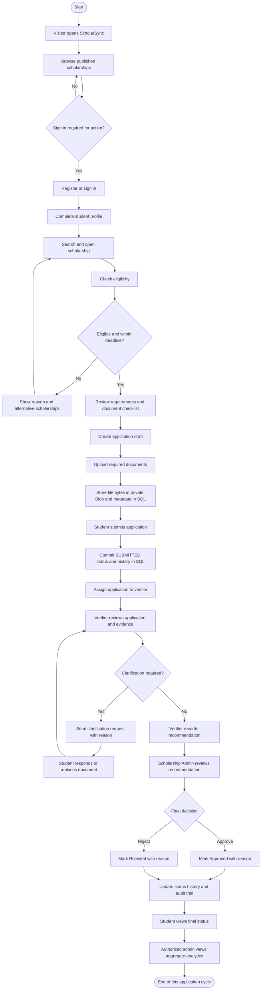
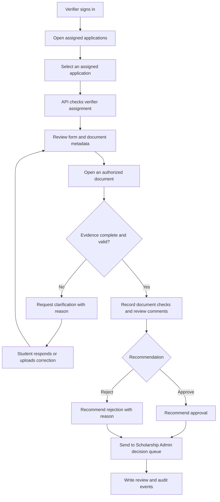
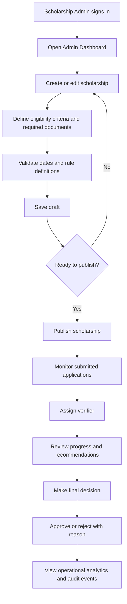

# ScholarSync — User Flow and Interaction Specification

**Project:** ScholarSync — Smart Scholarship Application, Verification & Tracking Platform  
**Document:** `user flow.md`  
**Version:** 1.0  
**Status:** Proposed baseline for implementation and academic review  
**Primary readers:** Development team, project guide, testers, and the Antigravity implementation agent

> **Document status:** This file specifies the intended product behaviour. It is not proof that the application has already been implemented. Antigravity must implement the flows below, add tests, and mark a flow as complete only after the acceptance criteria pass.

---

## 1. Product Purpose

ScholarSync provides one controlled workflow for the scholarship lifecycle. A student can discover scholarships, review eligibility, submit an application, upload supporting documents, respond to clarification requests, and track the final outcome. A verifier reviews assigned applications and records recommendations. Scholarship administrators manage scholarship opportunities, eligibility rules, assignments, and final decisions. System administrators manage user accounts, roles, security configuration, and audit access.

The core lifecycle is:

**Discover → Check Eligibility → Apply → Upload Documents → Verify → Clarify / Recommend / Decide → Track → Analyze → Audit**

The application is a modular monolith. The React client communicates with a Node.js/Express REST API. The API enforces business rules and authorization, stores structured records in Azure SQL Database, and stores document bytes in private Azure Blob Storage. Power BI is used for the project analytics report; the in-product administrator dashboard must also work through authorized application APIs and must not depend on a public Power BI embed.

## 2. Actors and Access Boundaries

### 2.1 Public visitor

A visitor who has not signed in. A visitor may view public pages and published scholarship summaries. A visitor cannot access student profiles, application details, uploaded files, verifier work queues, administrative pages, or audit records.

### 2.2 Student

An authenticated student who can:

- Manage their own student profile.
- Browse and filter published scholarships.
- Evaluate eligibility against published criteria.
- Start and submit an application, subject to the scholarship deadline and application policy.
- Upload required supporting documents.
- View only their own applications, documents, status history, clarification requests, and outcomes.
- Respond to clarification requests and replace or add documents where permitted.

### 2.3 Verifier / Faculty

An authenticated verifier who can:

- View only applications assigned to them (unless an explicitly approved elevated permission is implemented).
- Review application information and supporting documents.
- Mark document checks, record comments, request clarification, and record a recommendation.
- Never directly grant themselves an assignment or change a final decision without the required permission.

### 2.4 Scholarship Administrator

An authenticated scholarship administrator who can:

- Create, edit, publish, close, and archive scholarship records.
- Define and validate scholarship eligibility criteria.
- Assign applications to verifiers.
- Monitor application progress.
- Make the final approval/rejection decision under the default workflow in this specification.
- View authorized operational analytics and application activity.

**Default approval policy:** the verifier reviews evidence and recommends an outcome; a Scholarship Administrator records the final approval or rejection and a reason. The college/faculty must confirm this policy before release. If the approved institutional workflow differs, change the transition rules and permissions centrally—not in individual frontend components.

### 2.5 System Administrator

An authenticated system administrator who can:

- Create, disable, and manage users.
- Assign or change roles according to project governance.
- Review security configuration and restricted audit records.
- Investigate access and operational issues.

System administration does not automatically grant unrestricted access to document contents. Document access must still follow a deliberately defined permission policy and be logged.

## 3. Role and Permission Matrix

| Capability | Visitor | Student | Verifier | Scholarship Admin | System Admin |
|---|---:|---:|---:|---:|---:|
| View public scholarship listings | Yes | Yes | Yes | Yes | Yes |
| Register / sign in | Yes | Yes | Provisioned account | Provisioned account | Provisioned account |
| View or edit own profile | No | Yes | Limited account profile | Limited account profile | Account administration |
| View a student's private profile | No | Own only | Assigned cases only | Authorized scope | Only when needed and explicitly permitted |
| Submit an application | No | Yes | No | No | No |
| Upload application documents | No | Own application only | No, unless an approved correction workflow is added | No by default | No by default |
| View application documents | No | Own only | Assigned cases only | Authorized cases | Only when explicitly permitted |
| Create / publish scholarships | No | No | No | Yes | Optional platform override; log every use |
| Assign verifiers | No | No | No | Yes | Optional platform override; log every use |
| Record verifier review | No | No | Assigned cases only | No, unless explicitly assigned | No by default |
| Make final decision | No | No | Recommendation only | Yes (default policy) | No by default |
| View aggregate analytics | No | Personal status only | Assigned-work summary | Yes | Yes, operational scope |
| View audit logs | No | No | Own relevant actions only, if exposed | Restricted business events | Restricted security events |
| Manage user roles | No | No | No | No | Yes |

**Enforcement rule:** the backend must enforce role and record-level permissions on every protected request. Hiding a button or route in React is not authorization. The default must be deny unless an explicit permission permits the action.

## 4. High-Level End-to-End Flow

## 5. Detailed Student Journey

### 5.1 Public discovery

1. The student or visitor opens the home page.
2. The site shows its purpose, public navigation, and published scholarships.
3. Scholarship listing results show only information approved for public display, such as title, provider, summary, deadline, and public eligibility summary.
4. Search and filters narrow the list by supported fields such as category, department, deadline, and award range.
5. The server paginates results. The browser must not download the entire scholarship or applicant database.
6. Opening a scholarship shows the description, eligibility criteria, deadline, required document types, and application instructions.

**Expected outcomes:** the visitor can understand an opportunity without seeing private student or administrative data. Draft, unpublished, closed, or restricted scholarship records are not exposed unless the business rules explicitly permit them.

### 5.2 Registration and login

1. A new student selects Register and submits the required identity and account fields.
2. The API validates and normalizes the email address, checks uniqueness, validates the password policy, hashes the password, and creates a `Users` record with the `STUDENT` role.
3. The student completes the student profile, which is stored in `Students` and linked one-to-one to `Users`.
4. An existing user submits login credentials.
5. The API verifies the password hash, applies login throttling, and issues the configured authentication session/token.
6. The frontend obtains the signed-in user's role and routes the user to the correct dashboard.

**Security behaviour:** passwords are never stored in plaintext. Tokens, password hashes, connection strings, storage keys, and other secrets must never be returned to the browser or written to logs. The implementation should use a secure, HTTP-only cookie for the browser session and a CSRF defence for state-changing cookie-authenticated requests. If the team chooses a different token transport, the implementation plan and threat model must explain and test it.

**Account recovery:** include a safe password-reset flow only if the team has a real delivery mechanism (for example, a configured institutional email provider). Do not show a fake “email sent” success if no delivery service is configured. If recovery is not implemented for the first milestone, state that clearly in the UI and documentation.

### 5.3 Profile completion

1. The student opens My Profile.
2. The frontend loads only the signed-in student's profile.
3. The student enters the minimum information required by the supported eligibility criteria.
4. The API validates the fields and saves the profile.
5. The profile page indicates which required fields are missing.

Collect only information needed for scholarship eligibility and application processing. Do not add Aadhaar numbers, bank details, or other high-risk identifiers unless the college explicitly requires them and approves the handling, access, and retention rules.

### 5.4 Scholarship search and eligibility check

1. The student searches or filters the published scholarship list.
2. The student opens a scholarship detail page.
3. The student selects Check Eligibility.
4. The backend evaluates the scholarship's active criteria against the student's saved profile.
5. The result is one of:
   - **Eligible:** all mandatory criteria are satisfied.
   - **Not eligible:** at least one mandatory criterion is not satisfied; show a clear, non-sensitive reason.
   - **Profile incomplete:** one or more required profile values are missing; tell the student which fields need completion.
   - **Closed/expired:** the application period is not open or the deadline has passed.
6. The eligibility result is advisory until application submission. The backend must re-check eligibility and deadline when the application is submitted so a user cannot bypass the rule by editing browser requests.

**Rule-engine restriction:** criteria use an allowlisted set of fields and operators. Never evaluate arbitrary JavaScript, SQL, or user-provided code from a criterion value. Validate type, operator, and value before evaluation.

### 5.5 Application creation and document checklist

1. An eligible student selects Apply.
2. The API checks that the scholarship is published/open, its deadline has not passed, the profile contains required values, and the duplicate-application policy permits another submission.
3. The API creates a `DRAFT` application and returns its reference so later uploads are attached to the correct application.
4. The UI presents the application form and the scholarship-specific required document checklist.
5. The student enters application-specific answers and uploads the required files to that draft.
6. The frontend displays per-file progress and clear validation errors.

**Default duplicate policy:** one application per student per scholarship, enforced with a database uniqueness constraint. If the faculty permits reapplication after rejection or withdrawal, revise the database key and rule before implementation. Draft support is the baseline because files need to be associated with an application before final submission; if the faculty rejects drafts, Antigravity must implement a temporary upload-staging design instead.

### 5.6 Secure document upload

1. The student chooses a file for an application they own.
2. The API authenticates the student and verifies ownership of the application before accepting the upload.
3. The API checks the allowed extension, detected content type/file signature, maximum size, and required document type. It does not trust the browser's `Content-Type` header or filename.
4. The backend creates a generated opaque blob name. The original filename is stored only as safe metadata after sanitization.
5. The file bytes are saved in a private Azure Blob Storage container using the App Service's managed identity where configured.
6. The API stores document metadata in the `Documents` table: application, uploader, document type, opaque blob name, content type, size, verification status, and upload time.
7. The backend returns a safe document record, not an account key or permanent public blob URL.
8. The student sees a successful upload status.

**Failure handling:** blob upload and SQL metadata insertion are not one distributed transaction. If the blob upload succeeds but the metadata insert fails, the backend must attempt cleanup and record the failure. If metadata is created first, the record must remain in a clearly defined pending state until the blob operation succeeds. Implement one consistent sequence and a cleanup/reconciliation strategy; do not silently leave orphaned private files.

**Minimum initial file policy:** configurable allowlist such as PDF, JPG/JPEG, and PNG, with a conservative configurable maximum size. The exact list, maximum size, retention duration, and whether malware scanning is available must be approved by the team/faculty before real student documents are accepted.

### 5.7 Application submission

1. The student reviews the entered details and document checklist.
2. The student confirms Submit.
3. The backend repeats deadline, eligibility, ownership, required-field, document, and duplicate checks against the existing `DRAFT` record.
4. The backend changes the application to `SUBMITTED` and writes the initial submission status-history event in a single Azure SQL transaction.
5. The system makes the application available to the Scholarship Admin for assignment.
6. The student sees a submission reference and current status.

If database work fails, roll back the application transaction and show a retry-safe message. The frontend must prevent accidental repeated clicks, and the backend must remain idempotent enough to avoid duplicate submissions.

### 5.8 Application tracking

The student opens My Applications and sees only their own records. The list shows scholarship title, submission date, current status, last updated date, and a link to details. Application details show the status timeline, clarification requests, and the student's own uploaded-document metadata. Students cannot edit a submitted application unless its status and business rules explicitly permit a correction.

### 5.9 Clarification loop

1. The verifier or authorized administrator identifies missing, unreadable, inconsistent, or incomplete information.
2. The authorized user records a clarification action and a specific reason/request.
3. The application moves to `CLARIFICATION_REQUESTED` and the request appears in the student's application details.
4. The student reviews the request and submits a response or replacement document.
5. The API verifies that the application is in a clarification state and that the student owns it.
6. The new response/document is recorded; prior history is retained rather than overwritten.
7. The application returns to `UNDER_REVIEW` and the assigned verifier is notified in the application interface.
8. The verifier continues review.

The clarification loop can occur more than once, subject to policy and deadline rules. Each request and response must be attributable and timestamped.

### 5.10 Final decision

1. The verifier completes review and records `RECOMMEND_APPROVAL` or `RECOMMEND_REJECTION` with supporting comments, or records another permitted review outcome.
2. The application enters the corresponding recommendation state.
3. Under the default policy, the Scholarship Admin reviews the application, evidence, verifier recommendation, and history.
4. The Scholarship Admin selects Approve or Reject and supplies a reason.
5. The API validates that the actor has final-decision permission and that the current state permits the transition.
6. The update, status history, and audit event are committed consistently.
7. The student sees the final outcome and decision reason appropriate for student visibility.

A verifier must not directly set `APPROVED` or `REJECTED` under the default policy. The database/API must reject invalid transitions even if a user manually calls an endpoint.

## 6. Verifier / Faculty Journey

Verifier screens:

- Verifier dashboard: counts of assigned, awaiting review, clarification pending, and completed cases.
- Assigned applications: paginated queue with filters and deadlines.
- Application review: permitted student/application fields and document list.
- Document review: safe file viewing/download through an authorized backend endpoint.
- Review action: verify, request clarification, recommend approval, or recommend rejection.
- Review history: prior actions for that case.

Every application/document read must confirm both the verifier role and assignment to that application. A verifier must not gain access merely by guessing an application ID.

## 7. Scholarship Administrator Journey

Administrative functions:

- Scholarship create/read/update/publish/close/archive.
- Criteria and document-requirement configuration.
- Application queue and assignment.
- Final decision queue.
- Aggregate dashboard and report filters.
- Restricted audit log view.

Scholarship publishing must validate a deadline after the start date, supported criteria fields/operators, required document rules, and a non-empty description. A published scholarship must not be silently changed in a way that retroactively alters the eligibility basis of already-submitted applications; material rule changes should be versioned or blocked after applications begin.

## 8. System Administrator Journey

1. Sign in using a pre-provisioned administrative account.
2. Open User Management.
3. Search for an account using permitted identifiers.
4. Create/disable an account or change a role only after the required authorization.
5. Record a reason for privileged role changes.
6. Review relevant security/audit events.
7. Never view or export sensitive data unless a specific operational purpose and permission authorize it.

Role changes are security-sensitive events and must be recorded with actor, target user, previous role, new role, timestamp, and reason. Never allow a user to promote themselves to Scholarship Admin or System Admin.

## 9. Application Status Model

The following statuses provide a controlled lifecycle. Antigravity must implement them as a server-side allowlisted enum and a tested transition matrix.

| Status | Meaning | Who can cause it |
|---|---|---|
| `DRAFT` | Application started but not submitted; baseline state used to attach documents before final submission | Student / system on draft creation |
| `SUBMITTED` | Application passed submission checks | System on student submission |
| `UNDER_REVIEW` | Application is assigned/being reviewed | Scholarship Admin assignment or system transition after resubmission |
| `CLARIFICATION_REQUESTED` | Student action is required | Assigned verifier or authorized admin |
| `RESUBMITTED` | Student has supplied requested information | Student action; system records it |
| `VERIFIED` | Required evidence has been checked | Assigned verifier |
| `RECOMMENDED_FOR_APPROVAL` | Verifier recommends approval | Assigned verifier |
| `RECOMMENDED_FOR_REJECTION` | Verifier recommends rejection | Assigned verifier |
| `APPROVED` | Final approval decision | Scholarship Admin under default policy |
| `REJECTED` | Final rejection decision | Scholarship Admin under default policy |
| `WITHDRAWN` | Student withdraws, if institutional policy permits | Student before final decision, subject to policy |

### 9.1 Allowed transition outline

- `DRAFT → SUBMITTED`
- `SUBMITTED → UNDER_REVIEW`
- `UNDER_REVIEW → CLARIFICATION_REQUESTED`
- `CLARIFICATION_REQUESTED → RESUBMITTED`
- `RESUBMITTED → UNDER_REVIEW`
- `UNDER_REVIEW → VERIFIED`
- `VERIFIED → RECOMMENDED_FOR_APPROVAL` or `RECOMMENDED_FOR_REJECTION`
- `RECOMMENDED_FOR_APPROVAL → APPROVED` or `REJECTED` (final actor decides)
- `RECOMMENDED_FOR_REJECTION → REJECTED` or, where a documented override is allowed, `APPROVED` with a mandatory reason
- An allowed non-final state may transition to `WITHDRAWN` only if policy permits.

The implementation may simplify intermediate statuses if the faculty rubric requests it, but it must retain the key controls: no direct client-supplied final status, no invalid jumps, reasoned final decisions, and complete history.

## 10. Core Data and Integration Events

| User action | Azure SQL data | Blob Storage | Analytics / audit |
|---|---|---|---|
| Register | `Users` | None | Account-created audit event |
| Complete profile | `Students` | None | Profile-updated event where appropriate |
| Create scholarship | `Scholarships`, `EligibilityCriteria` | None | Admin audit event |
| Submit application | `Applications`, `ApplicationStatusHistory` | Existing uploaded document blobs + metadata | Submission event |
| Upload document | `Documents` metadata | File bytes | Upload success/failure event without file contents |
| Assign verifier | `Applications.assigned_verifier_user_id` | None | Assignment event |
| Verify / request clarification | `Verifications`, status history | None unless new file uploaded | Review/decision audit event |
| Final decision | `Applications`, status history | None | Decision event and aggregate report source |
| View analytics | Read-only aggregate view/query | None | Report access event if required by policy |

Power BI should use a read-only reporting view or an approved read-only data principal. It must not receive Blob Storage access or operational write permissions. The website administrator dashboard should read approved aggregates from the backend API.

## 11. Error, Exception, and Recovery Flows

| Scenario | Expected behaviour |
|---|---|
| Student is not signed in | Redirect to login for protected actions; do not return private data |
| Student requests another student's application | Return 404 or 403 consistently; log the authorization failure without exposing record details |
| Verifier opens an unassigned application | Deny and log the attempt |
| Scholarship deadline passes during form completion | Re-check on submit and reject submission with a clear message |
| Student is ineligible | Explain the failing published criteria at an appropriate level; do not create a submitted application |
| Required profile field is missing | Identify the missing field and link to profile completion |
| Duplicate application | Reject using backend validation and a database unique constraint |
| Unsupported/oversized/malformed file | Reject before storage; show a safe file-specific message |
| Blob upload fails | Do not mark the document as successfully uploaded; preserve a retry-safe state |
| SQL transaction fails | Roll back; do not show a successful application submission |
| User submits status change outside workflow | Reject server-side and log the invalid transition |
| Power BI service unavailable | The core application and React admin dashboard continue to function; report export may be temporarily unavailable |
| Azure SQL/Blob unavailable | Show a controlled service error; do not expose connection details or secrets |

## 12. Audit Events

At minimum, record the following events:

- Account registration, login success/failure, logout/session invalidation where available.
- Profile create/update.
- Scholarship create/update/publish/close/archive.
- Eligibility rule changes.
- Application submit, assignment, clarification request, student response, verifier action, final decision, and withdrawal.
- Document upload success/failure and authorized document access where practical.
- Role creation/change/disable operations.
- Authorization denials on sensitive operations.
- Analytics report access/export where required.

Each event should include actor (nullable for system events), action, entity type, entity identifier, timestamp, outcome, and correlation/request ID. Do not log passwords, tokens, SAS URLs, storage keys, full document contents, or unnecessarily sensitive personal details.

## 13. UX and Accessibility Requirements

- Responsive layouts for desktop, tablet, and mobile.
- Clear role-specific navigation and page headings.
- Visible loading, empty, success, and error states.
- Status chips must include text, not colour alone.
- Forms must label inputs, show inline validation, preserve safe user input after recoverable errors, and clearly identify required fields.
- File upload must state allowed formats and size limits before selection.
- Tables must support keyboard navigation, pagination, and readable mobile behaviour.
- Avoid unnecessary animation, crowded cards, and misleading dashboard metrics.
- Use accessible contrast, visible focus styles, semantic HTML, and meaningful labels for icon-only controls.

## 14. Acceptance Criteria for the Complete User Flow

The user-flow milestone is accepted only when all of the following pass:

1. A visitor can browse only published public scholarships.
2. A student can register, sign in, complete a profile, and view only their own data.
3. Eligibility is evaluated on the server using validated, allowlisted criteria.
4. Application submission re-checks eligibility, deadlines, required fields, and duplicates.
5. Documents are stored in a private Blob container and are accessible only through authorized backend operations.
6. A verifier can view only assigned applications and can record review actions and clarification requests.
7. A student can respond to a clarification request, and history is retained.
8. A verifier recommendation and the final decision are separate under the default approval policy.
9. Only an authorized Scholarship Admin can record the final decision under the default policy.
10. Invalid status transitions and direct client attempts to set final statuses are rejected.
11. Every important transition is visible in the application history and audit records.
12. Aggregate analytics do not expose private student documents or unnecessary personal data.
13. Role-negative tests demonstrate that unauthorized users cannot read or modify protected records.
14. The live deployed workflow works end-to-end, not only with mocked frontend data.

## 15. Decisions That Require Faculty / Team Confirmation

These decisions must be resolved before accepting real student information:

- Final approval authority and any multi-level approval chain.
- Whether draft applications and withdrawals are supported.
- Whether one application per student per scholarship is a strict rule or reapplication is allowed after rejection.
- Exact eligibility attributes, operators, boundary rules, and explanation text.
- Permitted document formats, maximum file size, malware scanning, and retention/deletion period.
- Whether password recovery/email notifications are required and which delivery provider is available.
- Whether verifiers can see all application profile attributes or only a minimum subset.
- Whether Power BI is a local academic report only or must be shared online; online sharing depends on separate Power BI licensing and tenant settings.

---

## References

The following official guidance informs the access-control and file-handling recommendations:

- [OWASP Authorization Cheat Sheet](https://cheatsheetseries.owasp.org/cheatsheets/Authorization_Cheat_Sheet.html)
- [OWASP File Upload Cheat Sheet](https://cheatsheetseries.owasp.org/cheatsheets/File_Upload_Cheat_Sheet.html)
- [OWASP Logging Cheat Sheet](https://cheatsheetseries.owasp.org/cheatsheets/Logging_Cheat_Sheet.html)
- [Microsoft — Secure your Azure Blob Storage](https://learn.microsoft.com/en-us/azure/storage/blobs/secure-blobs)
- [Microsoft — Azure SQL Database network access controls](https://learn.microsoft.com/en-us/azure/azure-sql/database/network-access-controls-overview)
